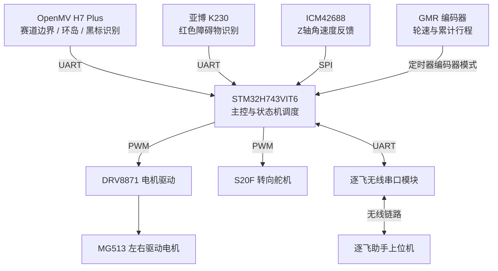

**简体中文** | [English](README_EN.md)

# 基于视觉识别与惯性反馈的智能车作品设计

## 一、系统概述

本作品是一套基于 **STM32H743VIT6** 的自主循迹智能车系统。视觉感知由 **OpenMV H7 Plus** 与 **亚博 K230** 分工承担，分别负责赛道特征提取与红色障碍物检测；姿态与运动反馈由 **ICM42688** 六轴陀螺仪与 **GMR 编码器** 提供。

系统实现了常规视觉巡线、单边丢线补线、陀螺仪辅助环岛通行、固定路线障碍绕行以及起跑线黑标计数停车等功能，并集成逐飞无线串口模块，支持实时遥测波形监控、在线调参与远程启停。

---

## 二、硬件架构与选型

| 功能模块 | 核心器件 / 型号 | 系统职责 |
| :--- | :--- | :--- |
| **主控制器** | STM32H743VIT6 | 多源传感器融合、运动控制解算、状态机调度及异常保护 |
| **赛道视觉** | OpenMV H7 Plus | 赛道左右边线提取、环岛特征识别及终点黑标检测 |
| **障碍视觉** | 亚博 K230 | 红色障碍物颜色阈值分割与触发判定 |
| **惯性测量** | ICM42688 | 通过 SPI 输出车身 Z 轴角速度，用于环岛与绕障姿态闭环 |
| **动力执行** | MG513 电机 + DRV8871 驱动 | 双后轮独立 PWM 调速驱动 |
| **转向执行** | S20F 180° 舵机 | 前轮转向角度控制（已做软件限幅与机械中位标定） |
| **里程反馈** | GMR 编码器 | 实时轮速闭环反馈与定距绕障行程累计 |
| **遥测交互** | 逐飞无线串口 + 逐飞助手 | 运行状态回传、波形监控、在线调参及无线启停控制 |

---

## 三、总体方案与软件调度

### 3.1 异构分工架构

为降低主控算力负载并保证控制周期的确定性，系统采用“感知—控制分离”的异构架构：OpenMV 与 K230 在端侧完成图像采集与特征提取，仅通过 UART 向 STM32H743 发送精简的状态帧或单字节触发指令；所有底层 PID 闭环、状态机切换及安全保护均在主控本地独立完成，不依赖上位机在线保活。



### 3.2 非阻塞任务调度

环岛、绕障与终点停车等复合任务均基于**非阻塞状态机**设计。系统以状态标志、系统滴答计时、陀螺仪累计转角及编码器累计行程作为状态跳转条件，全程规避 `HAL_Delay()` 等阻塞延时，确保任务执行期间轮速闭环、串口通信与丢线保护始终处于实时响应状态。

---

## 四、视觉感知与循迹设计

### 4.1 边界提取与单边补线

OpenMV 采集赛道图像后，基于设定阈值提取左右边线并计算当前位置偏差，经串口下发至主控驱动舵机转向。当车辆处于大曲率弯道或局部视野遮挡导致单侧边线丢失时，系统调用预先标定的赛道宽度模型（`ring_width_calibration.json`），依据可见侧边线推算虚拟中线，维持转向控制的连续性。

### 4.2 自适应预瞄控制

在当前位置偏差比例控制的基础上，系统引入动态预瞄修正机制，结合前方赛道曲率提前调整舵机打角以抑制过弯滞后。预瞄输出链路内置了**有效帧确认、增益缩放、输出限幅及变化率限幅**四级滤波保护，有效过滤单帧图像噪点对转向机构的冲击。

---

## 五、核心控制与任务策略

### 5.1 底层驱动与双闭环执行

* **轮速闭环**：主控按固定采样周期读取左右 GMR 编码器脉冲，换算实际轮速后通过增量式 PI 控制器调节 DRV8871 的 PWM 占空比，同时保留堵转与异常停车保护。
* **舵机控制**：转向控制量经软件限幅与速率平滑后映射为 PWM 脉宽，以机械标定的直行中位为基准输出至 S20F 舵机。

### 5.2 陀螺仪辅助环岛控制

ICM42688 平放安装（Z 轴垂直地面），系统上电静止时自动完成零偏校准。环岛通行严格按以下状态流转：

1. **特征触发**：OpenMV 识别到环岛入口特征，主控切换至回中直行准备姿态；
2. **陀螺仪入环**：切入角速度辅助转向，引导车身顺滑切入环岛；
3. **角度清零与绕环**：相机确认完全入环后清零积分角度，绕环期间闭环跟踪目标角速度（`287 °/s`）；
4. **定角出环**：当同向净累计转角达到触发门限（`287°`）时执行出环动作，随后平滑交还普通视觉循迹。

### 5.3 红色障碍物识别与固定绕行

K230 实时统计画面中红色阈值像素占比，当占比严格超过设定门限时，通过 UART 向主控发送单字节触发指令 `R`（单次目标仅触发一次，防止重复响应）。

主控收到 `R` 后立即接管控制权进入独立绕障模式，屏蔽期间的重复触发信号，控制车辆沿固定左侧轨迹绕行：

* **转向阶段**：以 ICM42688 积分角度作为转角到位判据；
* **直行阶段**：以左右编码器平均累计转数作为定距行驶判据；
* **循迹恢复**：固定路径执行完毕后进入回归过渡态，待连续接收到有效赛道中心线数据后恢复常规巡线。

### 5.4 黑标计数与终点停车

起跑线标记由横向排列的 8 条黑色短线构成，OpenMV 复用现有二值化图像与局部 ROI 检测整组黑标是否存在，主控负责状态确认与计数：

| 经过次数 | 系统判定与执行动作 |
| :--- | :--- |
| **第 1 次** | 计数值置 1，保持正常循迹 |
| **第 2 次** | 计数值置 2，保持正常循迹 |
| **第 3 次** | 计数值置 3，持续监测黑标直至其完全离开检测视野（经连续帧消抖确认） |
| **离开确认后** | 启动 `1000 ms` 非阻塞定时器，维持当前姿态直行冲线；定时结束立即切断电机输出并锁定停车状态（锁定后屏蔽常规启动指令） |

---

## 六、控制参数与遥测调试

### 6.1 核心控制参数（DebugRingFastLimit2 档位）

| 控制维度 | 参数项 | 设定值 |
| :--- | :--- | :--- |
| **速度闭环** | 普通直道目标轮速 | `7.6 圈/秒` |
| **速度闭环** | 普通弯道目标轮速 | `5.0 圈/秒` |
| **环岛控制** | 入环 / 绕环外轮目标轮速 | `7.6 圈/秒` |
| **环岛控制** | 环岛目标角速度 | `287 °/秒` |
| **环岛控制** | 出环触发净累计角度 | `287 °` |

### 6.2 遥测监控与启动机制

通过逐飞助手上位机可实时观测双轮目标/实际转速、电机 PWM 占空比、舵机输出脉宽、陀螺仪角速度与积分角度、环岛/绕障状态机阶段及视觉丢线标志。车辆同时支持 `PE7` 物理按键启动与无线指令启动，两种方式均受统一的安全状态机约束；无线链路断开时车辆自动维持本地自主运行。

---

## 七、工程目录结构

```text
.
├── CarTest/
│   ├── openmv/
│   │   ├── ring_width_calibration.json        # 赛道宽度与环岛相机标定文件
│   │   └── ...                                # OpenMV 赛道与黑标识别源码
│   ├── k230_red_obstacle/                     # K230 红色障碍物识别源码
│   ├── build/DebugRingFastLimit2/
│   │   └── CarTest.elf                        # 当前档位 H743 配套可执行固件
│   └── ...                                    # STM32H743 主控工程及底层驱动源码
└── SHA256SUMS.json                            # 归档文件完整性校验清单
```
