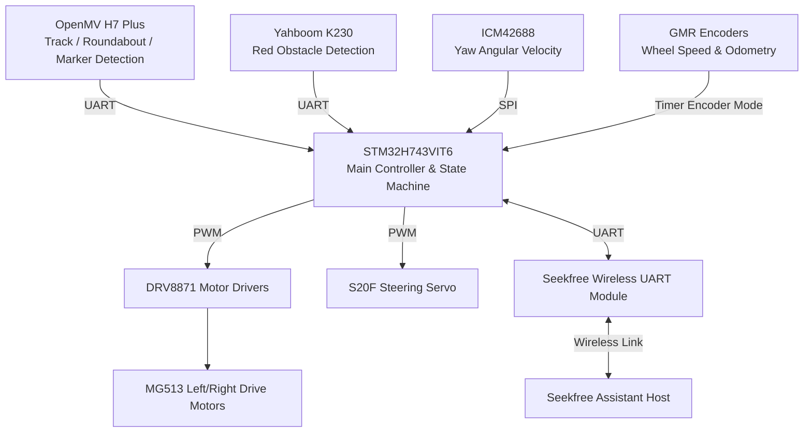

# Smart Car Competition Version

[简体中文](README.md) | **English**

# Autonomous Smart Car Design Based on Computer Vision and Inertial Feedback

## 1. System Overview

This project presents an autonomous line-tracking smart car powered by an **STM32H743VIT6** microcontroller. Visual perception is split between an **OpenMV H7 Plus** and a **Yahboom K230** for track feature extraction and red obstacle detection, respectively, while an **ICM42688** 6-axis IMU and **GMR encoders** provide attitude and odometry feedback.

The system supports standard visual line tracking, single-side line reconstruction, gyroscope-assisted roundabout navigation, fixed-path obstacle avoidance, and start/finish line marker counting for automated stopping. An integrated Seekfree wireless UART module enables real-time telemetry waveform monitoring, online parameter tuning, and remote start/stop control.

---

## 2. Hardware Architecture & Component Selection

| Subsystem | Core Component / Model | Role in System |
| :--- | :--- | :--- |
| **Main Controller** | STM32H743VIT6 | Multi-sensor fusion, motion control computation, state machine scheduling, and fault protection |
| **Track Vision** | OpenMV H7 Plus | Left/right track boundary extraction, roundabout feature recognition, and finish-line marker detection |
| **Obstacle Vision** | Yahboom K230 | Color-threshold segmentation and trigger detection for red obstacles |
| **Inertial Measurement** | ICM42688 | Outputs yaw angular velocity via SPI for closed-loop attitude control in roundabouts and obstacle bypass |
| **Drive Actuation** | MG513 Motors + DRV8871 Drivers | Independent dual rear-wheel PWM speed control |
| **Steering Actuation** | S20F 180° Servo | Front-wheel steering angle control (with software output limits and mechanical center calibration) |
| **Odometry Feedback** | GMR Encoders | Real-time wheel speed closed-loop feedback and fixed-distance travel accumulation |
| **Telemetry & UI** | Seekfree Wireless UART + Seekfree Assistant | Runtime telemetry streaming, waveform plotting, online parameter tuning, and wireless start/stop |

---

## 3. System Architecture & Software Scheduling

### 3.1 Heterogeneous Task Partitioning

To offload compute from the main MCU and guarantee deterministic control loop timing, the system adopts a decoupled perception-control architecture. Both the OpenMV and K230 handle image capture and feature extraction at the edge, transmitting only compact status frames or single-byte trigger commands to the STM32H743 over UART. All low-level PID loops, state transitions, and failsafe checks execute locally on the main controller without relying on a persistent host PC connection.



### 3.2 Non-Blocking Task Scheduling

Composite maneuvers—including roundabout traversal, obstacle avoidance, and finish-line stopping—are implemented using a **non-blocking state machine**. State transitions are driven by status flags, system tick timers, integrated yaw angles, and accumulated encoder counts, completely avoiding blocking calls such as `HAL_Delay()`. This ensures wheel speed control loops, UART communication, and line-loss failsafes remain responsive at all times.

---

## 4. Vision Perception & Line Tracking

### 4.1 Boundary Extraction & Single-Side Line Reconstruction

The OpenMV captures track frames, extracts left and right boundaries via calibrated thresholds, and computes lateral position error for steering control. When sharp corners or partial occlusions cause single-side boundary loss, the system references a pre-calibrated track width model (`ring_width_calibration.json`) to estimate a virtual centerline from the visible edge, maintaining steering continuity.

### 4.2 Adaptive Look-Ahead Control

Alongside proportional error correction, a dynamic look-ahead compensation term adjusts steering angles preemptively based on upcoming track curvature to reduce cornering lag. The look-ahead pipeline incorporates a four-stage filter—**valid-frame confirmation, gain scaling, output clamping, and slew-rate limiting**—to prevent single-frame visual noise from inducing steering jitter.

---

## 5. Core Control & Mission Strategies

### 5.1 Low-Level Actuation & Dual-Loop Control

* **Wheel Speed Loop**: The MCU samples left and right GMR encoder pulses at fixed intervals, calculates actual wheel speed, and regulates DRV8871 PWM duty cycles via an incremental PI controller with stall and fault-stop protection.
* **Servo Steering**: Steering commands undergo software clamping and slew-rate smoothing before mapping to PWM pulse widths centered around the mechanically calibrated neutral position.

### 5.2 Gyroscope-Assisted Roundabout Navigation

Mounted flat with its Z-axis perpendicular to the ground, the ICM42688 performs automatic zero-bias calibration while stationary at power-on. Roundabout traversal follows a strict four-stage sequence:

1. **Feature Trigger**: OpenMV detects roundabout entry geometry, prompting the MCU to align steering to straight-ahead preparation mode.
2. **Gyro-Assisted Entry**: Yaw-rate feedback guides the vehicle smoothly into the roundabout.
3. **Angle Reset & Circulation**: Once camera confirmation indicates full entry, accumulated yaw is zeroed and the controller tracks a target yaw rate (`287 °/s`).
4. **Angle-Triggered Exit**: When net accumulated rotation in the turn direction reaches the threshold (`287°`), the vehicle executes an exit maneuver and smoothly hands control back to standard visual tracking.

### 5.3 Red Obstacle Detection & Fixed-Trajectory Bypass

The K230 continuously computes the ratio of red-thresholded pixels in its field of view. Once the ratio strictly exceeds the configured threshold, it transmits a single-byte trigger (`R`) to the MCU over UART (debounced to fire once per obstacle encounter).

Upon receiving `R`, the MCU enters an isolated obstacle-avoidance mode, ignoring duplicate triggers while executing a fixed left-side bypass trajectory:

* **Turning Phases**: Guided by integrated yaw angle from the ICM42688.
* **Straight Phases**: Guided by average accumulated wheel rotations from the left and right encoders.
* **Tracking Recovery**: After completing the bypass path, the vehicle enters a re-entry transition state and resumes normal line tracking once consecutive valid centerline frames are received.

### 5.4 Black Marker Counting & Finish-Line Stop

The start/finish line marker consists of 8 transversely arranged short black bars. The OpenMV reuses its binarized frame and a local ROI to detect the marker group as a whole, while the MCU handles debounce confirmation and counting:

| Pass Count | System State & Action |
| :--- | :--- |
| **1st Pass** | Increment counter to 1; continue normal line tracking |
| **2nd Pass** | Increment counter to 2; continue normal line tracking |
| **3rd Pass** | Increment counter to 3; monitor marker until it completely exits the ROI (confirmed via consecutive-frame debouncing) |
| **Post-Exit Confirmed** | Start a `1000 ms` non-blocking timer while holding current trajectory across the finish line; upon timeout, cut motor output immediately and lock the stopped state (ignoring standard start commands while locked) |

---

## 6. Control Parameters & Telemetry

### 6.1 Core Control Parameters (`DebugRingFastLimit2` Profile)

| Control Domain | Parameter | Setpoint |
| :--- | :--- | :--- |
| **Speed Loop** | Straightaway Target Wheel Speed | `7.6 rev/s` |
| **Speed Loop** | Standard Corner Target Wheel Speed | `5.0 rev/s` |
| **Roundabout Control** | Entry / Circulation Outer-Wheel Target Speed | `7.6 rev/s` |
| **Roundabout Control** | Roundabout Target Yaw Rate | `287 °/s` |
| **Roundabout Control** | Exit Trigger Net Accumulated Angle | `287 °` |

### 6.2 Telemetry Monitoring & Startup Logic

Using the Seekfree Assistant host software, operators can monitor target vs. actual wheel speeds, motor PWM duty cycles, servo pulse widths, yaw rate and integrated angle, roundabout/bypass state machine stages, and line-loss flags in real time. The vehicle supports both `PE7` physical push-button start and wireless command start under unified safety interlocks, and continues autonomous execution locally if the wireless link drops.

---

## 7. Repository Structure

```text
.
├── CarTest/
│   ├── openmv/
│   │   ├── ring_width_calibration.json        # Track width & roundabout camera calibration file
│   │   └── ...                                # OpenMV track & finish-line marker vision source
│   ├── k230_red_obstacle/                     # K230 red obstacle detection source
│   ├── build/DebugRingFastLimit2/
│   │   └── CarTest.elf                        # Compiled H743 firmware for current speed profile
│   └── ...                                    # STM32H743 main project & low-level driver source
└── SHA256SUMS.json                            # Archive integrity checksum manifest
```
